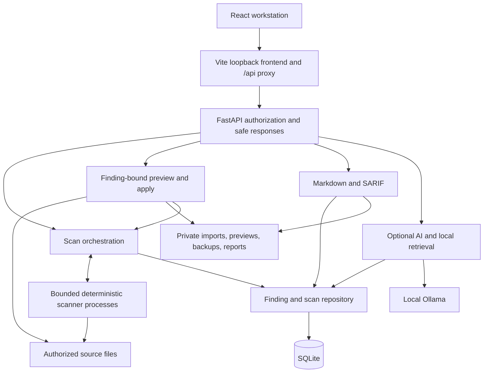

# AntiFine

AntiFine is a local infrastructure-security workstation for Terraform, Dockerfiles, Kubernetes manifests, and supported configuration files. It combines deterministic scanning, persisted findings, narrow automatic fixes, and exportable evidence in a React interface backed by a Python API.

The scanner owns findings, severity, compliance mappings, and remediation eligibility. Optional local Ollama explanations are advisory: AI cannot scan, edit files, execute commands, approve fixes, or change verification results.

AntiFine is intended for a trusted local workstation. It is not a hosted multi-user service or a complete compliance assessment.

## Contents

- [Features and coverage](#features-and-coverage)
- [Architecture](#architecture)
- [Technology and prerequisites](#technology-and-prerequisites)
- [Installation](#installation)
- [Quick start](#quick-start)
- [Using the workstation](#using-the-workstation)
- [CLI reference](#cli-reference)
- [API overview](#api-overview)
- [Deterministic remediation](#deterministic-remediation)
- [Secret detection and privacy](#secret-detection-and-privacy)
- [Storage and upgrades](#storage-and-upgrades)
- [Reports and exports](#reports-and-exports)
- [Optional Ollama integration](#optional-ollama-integration)
- [Configuration](#configuration)
- [Testing and CI](#testing-and-ci)
- [Security considerations and limitations](#security-considerations-and-limitations)
- [Repository hygiene](#repository-hygiene)
- [Contributing](#contributing)
- [License](#license)

## Features and coverage

The workstation provides project-folder/file imports, a private synthetic Terraform demo, authorized local-path scans, severity/file/status/rule-family filters, resource evidence, focused source diffs, explicit approval, persistent verification history, Markdown reports, and SARIF exports. Findings reload from the backend after a browser refresh. Dialogs support keyboard focus and Escape dismissal.

| Input | Implemented checks | Limits |
|---|---|---|
| Terraform `.tf` | Selected AWS security-group unrestricted IPv4/IPv6 SSH/RDP and all-protocol ingress checks; public RDS; missing S3 encryption/public-access-block configuration; parsed-value secret checks | Static source only. No plan, provider, module, variable, or deployed-state evaluation. S3 checks inspect configuration/reference presence, not effective bucket policy. |
| Names containing `dockerfile` | Explicit root/missing user; user/group syntax; unpinned/latest image checks; missing/disabled final-stage healthcheck; selected ENV/ARG secrets; intermediate-stage informational findings | Does not build images, inspect inherited image configuration, prove accounts exist, or execute healthchecks. |
| Kubernetes `.yaml` / `.yml` | Host namespaces, privileged containers, privilege escalation, non-root settings, writable root filesystems, capabilities, seccomp, resource limits, and secrets | Selected checks, not complete Kubernetes Pod Security Standards (PSS). |
| JSON, `.env`, `.env.*`, `.conf` | Nested JSON strings/arrays; quoted/unquoted assignments; implemented vendor signatures and entropy heuristics | Not a general parser for every configuration language or an exhaustive secret detector. |

PodSpec checks support Pods, Deployments, ReplicaSets, ReplicationControllers, StatefulSets, DaemonSets, Jobs, and CronJobs. They examine regular, init, and ephemeral containers, including supported Pod-level non-root/seccomp inheritance. Other YAML can receive structure/secret checks without a Pod policy assessment.

Severities are `CRITICAL`, `HIGH`, `MEDIUM`, `LOW`, and distinct `INFORMATIONAL`. Unknown and unevaluated evidence must not become passing compliance results. Framework/control mappings are finding metadata, not certified control passes.

Rules attach selected CIS, PCI DSS 4.0, NIST SP 800-190, CWE, and ISO 27001 labels where supplied by the implementation. Mapping coverage varies by rule; missing mappings are not inferred from finding text or AI output.

An optional SSRF probing path exists in the API and older CLI. It sends real network requests, uses response indicators, and reports partial coverage. It is separate from offline IaC scanning and the verified local fix workflow.

## Architecture



The API delegates scans to bounded child processes; the parent records evidence. Remediation reproduces a persisted finding, checks source bytes, makes an allowlisted edit, and rescans. AI reads sanitized context and has no source-write or approval path.

| Area | Source |
|---|---|
| Composition, local authorization, workstation/integration/AI routes | [src/api/](src/api/) |
| Orchestration, storage, workspaces, remediation, worker limits | [src/services/](src/services/) |
| Deterministic rules, bounded parsers, exact edits, secrets | [src/scanners/](src/scanners/) |
| Finding and AI-context contracts | [src/models/](src/models/) |
| SQLite bootstrap and migrations | [database/](database/), [scan_repository.py](src/services/scan_repository.py) |
| Markdown and SARIF | [src/reporting/](src/reporting/) |
| Static AI knowledge and lexical retrieval | [src/ai/](src/ai/), [docs/ai/](docs/ai/) |
| React components, hooks, types, API client | [frontend/src/](frontend/src/) |
| CLI utilities | [src/cli/](src/cli/), [src/main.py](src/main.py) |
| Regression suites | [tests/](tests/), [frontend/tests/e2e/](frontend/tests/e2e/) |

## Technology and prerequisites

The backend uses Python, FastAPI, Pydantic, Uvicorn, SQLite, `python-hcl2`/Lark, PyYAML, and JSON parsing. The frontend uses React, TypeScript, Vite, Tailwind CSS, Framer Motion, and Lucide icons. Validation uses pytest, JSON Schema, Oxlint, TypeScript, and Playwright/Chromium.

Use **Python 3.12 or 3.14**, **Node.js 24.x**, npm, and Git. CI targets Windows/Linux with Python 3.12/3.14 and Node 24 browser checks. Local release validation used Windows, Python 3.14.7, Node 24.20.0, and npm 11.19.0; this does not establish results for every target.

Source scanning needs no Terraform executable, Docker daemon, Kubernetes cluster, or cloud credentials. Ollama is optional. Dependency/browser/model downloads need network access; core source analysis needs no external scanning service.

Dependencies are pinned in [requirements.lock](requirements.lock), [requirements-dev.lock](requirements-dev.lock), and [frontend/package-lock.json](frontend/package-lock.json).

## Installation

Clone the branch containing this implementation:

```bash
git clone --branch codex/sprint-1-workflow https://github.com/ceopwersc/AntiFine.git
cd AntiFine
```

### Windows PowerShell

```powershell
py -3.14 -m venv .venv
.\.venv\Scripts\Activate.ps1
python -m pip install -r requirements-dev.lock
```

Without the Python launcher, use `python -m venv .venv` with a supported interpreter. If activation is restricted, call `.\.venv\Scripts\python.exe` directly instead of changing machine-wide execution policy.

### Linux / Bash

```bash
python3.14 -m venv .venv
source .venv/bin/activate
python -m pip install -r requirements-dev.lock
```

Substitute `python3.12` for that configured target. Your OS may require its Python venv package. Verify Linux operation for your environment; the CI definition alone is not a passing run.

Then, from the repository root:

```bash
npm --prefix frontend ci
```

The development lock includes runtime and test dependencies. Backend-only operation can use `python -m pip install -r requirements.lock`; tests also need the development dependencies.

## Quick start

In an activated Python environment, start the API from the repository root:

```bash
python -m uvicorn src.api.server:app --host 127.0.0.1 --port 8000 --no-access-log
```

In a second terminal, from the repository root:

```bash
npm --prefix frontend run dev -- --host 127.0.0.1 --port 5173 --strictPort
```

Open [the workstation](http://127.0.0.1:5173). Vite proxies `/api` to `127.0.0.1:8000`. Keep these ports: the local Origin policy explicitly permits 5173/8000 origins. Resolve port conflicts deliberately; a silently selected alternative port will not establish a valid session.

The browser establishes its local session automatically. Scanning and supported fixes work with AI disabled. Database initialization/migration occurs when persistence is first used; manual initialization is not required for the workstation.

To check the production bundle locally, run these commands instead of the development server:

```bash
npm --prefix frontend run build
npm --prefix frontend run preview -- --host 127.0.0.1 --port 5173 --strictPort
```

Vite preview is a local bundle check, not a supported public production hosting configuration.

## Using the workstation

1. Open **Scan** and choose an import or **Server-local path**. Imports are private copies; local-path fixes edit the actual authorized source.
2. Choose **Try safe Terraform demo**. It creates a private copy of [examples/terraform-workflow](examples/terraform-workflow/README.md): identical `dev/main.tf` and `prod/main.tf` files with a public `aws_db_instance.customer_demo` and a private sibling. No cloud credentials, Terraform executable, or AI setup is required. Never deploy these scan-only fixtures. **Choose project** imports your own folder while preserving relative paths.
3. Inspect coverage and open the finding drawer. Search/filters narrow persisted findings; the Secrets view withholds values.
4. Choose an eligible finding and **Review fix**. Check the exact file, resource, source version and scalar diff, explicitly check **I approve this exact change**, then apply. Preview failure keeps Apply disabled. Fixing an imported copy leaves the original project untouched.
5. Review the rescan and remaining findings, then download Markdown or SARIF from **Reports**.

Server-local paths are relative to `ANTIFINE_WORKSPACE_ROOT`, defaulting to the repository root; `tests/fixtures` selects the example directory. HTTP clients cannot select arbitrary absolute paths outside that root. Containment checks reject escapes, symlinks, junctions/reparse points, and ambiguous Windows path components.

Windows short-name aliases are compared using canonical paths after the original path has been checked for link/reparse traversal. This accepts equivalent authorized spellings while retaining containment and unsafe-name rejection.

Directory discovery inventories selected files, including unsupported formats, while excluding tool/cache directories such as `.git`, `.terraform`, virtual environments, `node_modules`, `dist`, and `build`. The project picker reports its excluded tool/cache file count; backend coverage lists every imported/selected file and its evaluated or attempted rule families. Unsupported entries make mixed scans partial. They never silently satisfy a security gate. Browser imports are bounded to 100 files/16 MiB; choose a focused infrastructure folder rather than a whole checkout with dependencies.

Responses distinguish `completed`, `partial`, and `error`, with per-file `evaluated`, `unsupported`, or `error` states. Completed scans can contain findings; an empty directory can be enumerated without evaluating a file. Read findings and coverage together. Neither case establishes compliance.

The Compliance view shows supplied mappings. Historical charts, durable report browsing, and editable organization/settings policies are incomplete capabilities.

## CLI reference

### Headless severity gate

Run from the repository root:

```bash
python -m src.cli.gate --help
python -m src.cli.gate --file Dockerfile.multistage_compliant --fail-on HIGH
```

The Dockerfile is a gate example; its name does not imply certification. Intermediate-stage informational findings can remain below the threshold. This negative example is expected to exit **1**:

```bash
python -m src.cli.gate --file tests/fixtures/public-database.tf --fail-on CRITICAL
```

| Option | Behavior |
|---|---|
| `--file PATH` | Required file or directory. CLI paths belong to the invoking OS account; HTTP workspace authorization does not apply. |
| `--fail-on LOW\|MEDIUM\|HIGH\|CRITICAL` | Minimum severity that fails the gate; default `HIGH`. |
| `--min-score INTEGER` | Legacy severity-weighted risk heuristic, not a compliance score/certification. Prefer the severity threshold. |
| `--allow-unsupported` | Explicitly assess supported files only; unsupported files remain unevaluated. Requires at least one evaluated file, no evaluation errors, and complete enumeration. Severity policy still applies. |
| `-h`, `--help` | Show usage. |

Exit **0** means evaluated files meet policy. Exit **1** means a threshold violation or unsupported, incomplete, or failed scanning; empty evaluation cannot pass. Argument-parser errors exit **2**. The gate does not persist findings or require HTTP authentication.

### Older orchestration commands

`python -m src.main --help` lists the older command surface, separate from the workstation:

| Option | Current behavior / limitation |
|---|---|
| `--init` | Initialize legacy database tables. Repository use triggers schema-v4 migration. |
| `--audit-iac FILE_OR_DIR` | Scan and persist unless `--dry-run` is supplied. Its exit code is not a severity gate. |
| `--audit-local` | Run `scripts/port_mapper.sh`; requires Bash and a supported port-listing utility. |
| `--audit-web URL` | Send active SSRF probes to an authorized target. |
| `--target-id INTEGER` | Legacy target bookkeeping, default `1`; modern IaC uses repository identities. |
| `--dry-run` | Avoid audit persistence; does not prevent network probes. |
| `--report` | Write legacy `compliance_report.md` in the repository, potentially overwriting it. Prefer private workstation export. |
| `--export-sarif FILE` | Export recorded open findings; choose a private output file. |
| `--ui`, `--gui` | Older Rich TUI and CustomTkinter GUI. GUI extras are in `requirements-gui.txt`; these are not the primary release-verified React interface. |
| `--audit` | Full-pipeline placeholder. A successful return does not mean an audit ran. |

`python -m src.cli.ai rebuild-index` rebuilds the static knowledge index under `.antifine/`; it does not create persistent chat memory or AI-generated findings.

## API overview

The API base is `http://127.0.0.1:8000`. Except for health and session bootstrap, requests need the browser session or `X-AntiFine-Token` matching the backend capability.

`POST /api/session` requires an approved local `Origin` and `X-AntiFine-Request: 1`. It sets an HttpOnly, SameSite=Strict cookie scoped to `/api`. The capability is generated per backend process unless `ANTIFINE_API_TOKEN` is configured before startup. Host, Origin, and loopback-peer checks also apply. CORS is not authentication; a hostile process already running under the same OS account is outside this protection model.

### Workstation routes

| Method | Route | Purpose / input |
|---|---|---|
| GET | `/api/health` | Unauthenticated liveness. |
| POST | `/api/session` | Local session bootstrap in middleware. |
| POST | `/api/scan/demo` | Create a private synthetic Terraform project; returns an opaque workspace ID. |
| POST | `/api/scan/upload` | Multipart `files`; optional JSON-array form field `relative_paths`. Returns an opaque workspace ID. |
| POST | `/api/scan/iac` | JSON `target_path`: authorized relative path or uploaded `workspace_*` ID. Returns status, findings, scan ID, coverage. |
| GET | `/api/findings` | Persisted current records, resource evidence, lifecycle and verification status. |
| POST | `/api/findings/{finding_id}/rescan` | Read-only rescan using persisted backend file identity; rejects caller paths. |
| GET | `/api/remediations` | Recent immutable approved pending/final remediation events. |
| GET | `/api/findings/secrets` | Open secret findings; safe metadata only. |
| GET | `/api/scan/history` | Recent runs, including clean/partial runs and coverage. |
| GET | `/api/dashboard` | Open-finding counts and mapping metadata. |
| GET | `/api/analytics/dashboard` | Severity/coverage data; compliance score is `null`, trends unavailable. |
| POST | `/api/scan/iac/remediation/preview` | JSON `finding_id`; source-bound preview. |
| POST | `/api/scan/iac/remediate` | JSON `finding_id`, current `preview_id`, and strict boolean `approved: true`; validate, back up, apply, rescan. |
| GET | `/api/scan/iac/export/sarif` | Current open findings, coverage and recent remediation evidence as SARIF 2.1.0. |
| POST | `/api/report/generate` | Create private Markdown; returns `results.markdown.file`. |
| GET | `/api/reports/{filename}` | Authenticated Markdown download. |

Upload and scanning are separate steps. There is no `/api/scan/iac/upload` route. A server-local scan payload is:

```json
{"target_path": "tests/fixtures/public-database.tf"}
```

A native client can use the installed HTTPX dependency. First configure the same `ANTIFINE_API_TOKEN` securely in the backend and client environments; keep its value out of source and command history:

```python
import os
import httpx

with httpx.Client(
    base_url="http://127.0.0.1:8000",
    headers={"X-AntiFine-Token": os.environ["ANTIFINE_API_TOKEN"]},
    timeout=60,
) as api:
    response = api.post(
        "/api/scan/iac",
        json={"target_path": "tests/fixtures/public-database.tf"},
    )
    response.raise_for_status()
    result = response.json()
    print(result["status"], result["findings_count"], result["coverage"])
```

For an import, scan the upload response's `target_path`. For a fix, use the finding's backend `id` as `finding_id`, never its title/display path. Validation errors intentionally omit rejected values. Invalid previews return 422; stale/rejected applies return 409. Applicable upload quota failures return 413.

### Optional AI and integration routes

| Method | Route | Purpose / constraint |
|---|---|---|
| GET | `/api/ai/health` | Enabled/model/availability state; contacts Ollama only when enabled. |
| POST | `/api/ai/ask` | `question`, optional context, bounded `messages`; finding context requires a backend `finding_id`. |
| POST | `/api/ai/findings/explain` | `finding` with backend `id`, optional `code_context`; reloads canonical metadata. |
| POST | `/api/ai/remediation/explain` | Review request with a current `preview_id`; backend reconstructs authoritative before/after content. |
| POST | `/api/ai/test` | Bounded, sanitized local developer prompt test; not a remote prompt proxy. |
| GET / POST | `/api/integrations/webhooks` | List/save allowlisted destinations; save accepts `url` and `min_severity`. |
| POST | `/api/integrations/test` | Schedule a real synthetic notification; success is not proof of delivery. |
| POST | `/api/scan/ssrf` | Active probes using `target_url`; observations have partial coverage. Requires authorization to test the target. |

FastAPI's schema describes registered route models; session bootstrap is middleware rather than an OpenAPI operation. Generated documentation/schema paths are also protected by local middleware, not anonymous public endpoints.

## Deterministic remediation

Automatic edits currently cover only these observed booleans:

- Terraform `aws_db_instance.publicly_accessible`: selected `true` to `false`.
- Kubernetes `securityContext.privileged` and explicit `securityContext.allowPrivilegeEscalation`: selected `true` to `false`.

Missing fields, ambiguous/shared YAML source, unsupported rules, and Docker user/healthcheck changes are manual-only. AntiFine does not invent an account or add `HEALTHCHECK CMD true` as an automatic fix.

A preview binds a persisted finding to its file/resource, source digest and candidate digest. It returns a bounded, sanitized source excerpt and unified diff with actual line numbers. Apply requires strict explicit approval, revalidates that source, creates an immutable private backup, records verification pending, uses atomic replacement, and reparses/rescans. A final verification event and rescan findings commit together. A source edit invalidates the preview. Title-based remediation requests are deliberately rejected.

Removing the selected finding while others remain records `resolved_with_findings` with `verified: false`. Only the original finding is resolved; the file retains its remaining findings. Introduced findings reject the operation and trigger rollback. Only a complete zero-finding file rescan is verified. Failed verification attempts to restore original bytes when safe; concurrent external changes prevent an unsafe rollback and require review.

Opaque backups are never silently overwritten and contain original source bytes. Recovery and quota-driven archival are operator filesystem tasks; there is no browser restore endpoint.

## Secret detection and privacy

Implemented signatures cover AWS key forms, GitHub tokens, selected Slack tokens, and private-key headers. Entropy heuristics have false-positive exclusions such as standard UUID/hash formats. Detection does not prove a token is live, and no finding does not prove a file is secret-free.

Central sanitization protects supported display/persistence fields, API responses/errors, previews, logs, exports, and AI context/output. The Secrets view exposes metadata rather than values. Redacted display paths cannot authorize writes. Raw Uvicorn request logging is suppressed in favor of safe route/status logging.

Raw bytes necessarily remain in selected local source files and private copies. Imports and backups stay outside Vite/static roots; keep your own source out of public directories too. Protect these files and keep real credentials out of fixtures and external logs. Pattern/context-based sanitization is conservative, not a formal guarantee for arbitrary hostile text. Preserve those boundaries when adding fields or transports.

## Storage and upgrades

| Data | Default |
|---|---|
| SQLite evidence | Repository `antifine.db`; override `ANTIFINE_DB_PATH`. |
| Authorized local source | Repository root; override `ANTIFINE_WORKSPACE_ROOT`. |
| Private imports/previews/backups/Markdown | `%LOCALAPPDATA%/AntiFine` on Windows, otherwise `~/.local/share/AntiFine`; override `ANTIFINE_DATA_DIR` outside the checkout. |
| Static AI knowledge index | Ignored `.antifine/knowledge_index.json`, from bundled rules and `docs/ai/`, not conversations. |

Private storage uses restrictive POSIX permissions or a protected owner/SYSTEM Windows DACL. Imports expire after 24 hours; cleanup runs on upload/workspace access, not a background scheduler. Previews expire after ten minutes; old records are cleaned during preview creation. Backups remain until operator archival. Generated reports have no automatic retention/quota policy.

Schema v4 stores current findings in `scan_results`, runs/coverage in `scan_runs`, independent per-run snapshots in `scan_evidence`, and immutable approval/verification events in `remediation_runs`. The additive v3-to-v4 migration preserves existing run evidence. Newly scanned Terraform resources have semantic address keys stable across resource reordering; ambiguous duplicate addresses fail closed. Legacy rows need a rescan to acquire the new metadata. Finding records carry backend IDs, rule/file/resource metadata, source digests, scan IDs, and regions where available. Workspace-relative identity distinguishes same-basename files. Legacy target/webhook tables remain for compatibility.

Successfully evaluated files reconcile prior open findings, including clean rescans. Failed files retain prior evidence. Removed files are reconciled after a successful complete enumeration of the same scope. The history and remediation APIs return their latest 100 records; current-finding reports are not full historical snapshot exports. Verification states include pending, verified resolved, resolved with findings, verification failed, rescan resolved and reopened. They describe recorded evidence, not live deployed state. A crash after a durable pending event leaves verification pending for operator review; there is no automatic crash recovery or restore UI.

Before an existing-database upgrade:

1. Stop older writers and keep any required backup in private storage.
2. Install pinned dependencies and start one upgraded writer to migrate.
3. Expect legacy findings/mappings to remain non-actionable until rescanned. Privacy migration intentionally redacts unsafe display values and retires credential-bearing legacy webhook URLs; it is not byte-for-byte reversible.
4. Reconfigure integrations as needed and rescan before automatic remediation.

SQLite secure deletion clears replaced cells during migration. Existing backups, exports, and filesystem snapshots are not retroactively sanitized.

## Reports and exports

- **Markdown:** `POST /api/report/generate`, then authenticated `GET /api/reports/{filename}`. The workstation downloads private evidence containing current open findings, mappings, supported identifiers/locations, recorded coverage, and immutable remediation history with backup and verification scan identifiers.
- **SARIF 2.1.0:** `GET /api/scan/iac/export/sarif`. Includes rule IDs, supported regions, finding/scan/resource properties, mappings, coverage and remediation history. Regression tests validate against the bundled SARIF schema.

The older CLI's `--export-sarif FILE` exports findings but does not populate the API's scan-coverage collection. Use private output paths and avoid overwriting evidence. Generated reports are ignored local outputs rather than versioned evidence of current source state.

**PDF generation is not implemented.** There is no PDF endpoint, report queue, or automatic compliance certification.

## Optional Ollama integration

Install/run Ollama locally and make the configured model available before enabling AI. The default `qwen2.5:7b` is configurable; it is not a model recommendation or hardware-sizing claim.

Set the following in the backend process environment or a local ignored `.env` based on [.env.example](.env.example):

```dotenv
OLLAMA_ENABLED=true
OLLAMA_BASE_URL=http://127.0.0.1:11434
OLLAMA_MODEL=qwen2.5:7b
OLLAMA_TIMEOUT=30
```

Unset/false `OLLAMA_ENABLED` disables AI; the example file opts in. The Ollama module loads root `.env` without overriding process variables. Restart after configuration changes and keep the model endpoint local.

Finding explanations use backend evidence; remediation explanations need a current preview. Chat history is request-bounded and not permanent memory. Local retrieval uses bundled rule/document knowledge. Sanitization and advisory guards handle supported disclosure/contradiction cases; model prose is never verification evidence.

Disabled generation returns 503; service failures generally return 502. AI health returns availability in its response. AI failure does not disable deterministic scanning or remediation. No autonomous patching or AI commands are implemented.

## Configuration

Set workstation/security variables in the **process environment before Python starts**. Do not rely on the optional Ollama `.env` loader to initialize an API capability or CLI configuration.

| Variable | Default / purpose |
|---|---|
| `ANTIFINE_WORKSPACE_ROOT` | Repository root; authorized server-local source. |
| `ANTIFINE_DB_PATH` | Repository `antifine.db`; SQLite location. |
| `ANTIFINE_DATA_DIR` | Platform private-data root above; must be outside the checkout. |
| `ANTIFINE_API_TOKEN` | Unset generates a per-process capability; native clients supply the configured value via `X-AntiFine-Token`. Never embed it in frontend code. |
| `ANTIFINE_WEBHOOK_ALLOWLIST` | Empty disables destinations; comma-separated exact hostnames, no wildcards. |
| `OLLAMA_ENABLED` | `false`; explicit model-request opt-in. |
| `OLLAMA_BASE_URL` | `http://127.0.0.1:11434`. |
| `OLLAMA_MODEL` | `qwen2.5:7b`. |
| `OLLAMA_TIMEOUT` | 30 seconds; minimum parsed value 0.1 seconds. |
| `ANTIFINE_BASH` | Optional Bash executable override for the older local port mapper. |
| `ANTIFINE_TEST_PYTHON` | Playwright backend interpreter; default `python`. Current command construction requires an override path without spaces. |
| `ANTIFINE_E2E_MANIFEST` | Browser-test runtime manifest; defaults to a temporary filename. Contains synthetic fixture locations. |
| `ANTIFINE_E2E_OUTPUT` | Playwright artifacts; defaults to OS temporary storage. |

`ANTIFINE_TESTING` is an internal TestClient peer/Host switch; do not enable it for normal operation.

Fixed limits include 2 MiB per source/uploaded file, 100 files and 16 MiB per imported workspace, 128 MiB total import bytes, 17 MiB per upload request, and 256 KiB for other bodies. Source scans select at most 500 files, 32 MiB aggregate content, and 2,000 aggregate findings. Workers have bounded concurrency, a ten-second per-file wall timeout, and OS memory/CPU budgets. Backups have a separate 128 MiB quota. These are code constants, not environment-tunable settings.

Webhooks require credential-free HTTPS/443, no query/fragment, an exact allowlisted host, and public DNS answers. Delivery revalidates DNS and pins a validated IP while retaining TLS hostname/certificate checks. Redirects are rejected; the transport does not inherit proxies. Secret-bearing paths are unsuitable; use an operator-controlled gateway for authentication. Integration test calls schedule real notifications.

## Testing and CI

From the repository root with development dependencies installed:

```bash
python -m pip check
python -m pytest -q
npm --prefix frontend run lint
npm --prefix frontend run typecheck
npm --prefix frontend run build
npm --prefix frontend audit
```

For browser workflows, activate the Python environment in the launching terminal. Stop workstation services on 8000/5173 first: the harness refuses to reuse them.

```bash
cd frontend
npx playwright install chromium
npm run test:e2e -- --repeat-each=2
```

Linux CI uses `npx playwright install --with-deps chromium` for system dependencies; this can need appropriate package-install permissions.

pytest configures temporary database/workspace/private roots before app imports. Playwright starts an isolated real API and built frontend preview with synthetic fixtures; failure artifacts go to temporary storage. Cases cover scans, same-basename/same-size nested imports, safe demo onboarding, preview rejection, explicit approval, exact resource edits, immutable backups, deterministic rescan, stale-source rejection with a real rescan, partial/malformed/unsupported coverage, persistent reload, evidence downloads, source confidentiality, navigation/filters, keyboard/responsive behavior, and report errors. AI/webhook security tests use mocks rather than live generation or external delivery.

The [release workflow](.github/workflows/security.yml) defines Windows/Linux Python 3.12/3.14 backend/CLI jobs and Linux Node 24 lint/typecheck/build/repeated-browser checks. A workflow definition is not a passing remote run; check GitHub Actions for the specific commit.

Historical audit-release evidence recorded **115 backend passes, one Windows symlink-privilege skip, and 12 repeated browser passes**. Sprint 1 validation and product scope are recorded in [the product roadmap](docs/PRODUCT_ROADMAP.md). The actual Windows junction test passed. [The A01-A16 implementation record](docs/SECURITY_REMEDIATION.md) describes fixes, evidence, and unverified environments. Current runs remain authoritative.

## Security considerations and limitations

- Run on loopback under a trusted local account. Public hosting, remote reverse proxies, multi-user authentication, and hostile same-user/administrator isolation are unsupported.
- Bounded parsers/workers, path revalidation, locks, and atomic writes reduce risk; they are not a formal OS sandbox or proof that every race is eliminated.
- Static checks/mappings do not establish deployed security, full CIS/PCI DSS coverage, complete Kubernetes PSS compliance, or certification. Unsupported/unevaluated input cannot satisfy the CLI gate or remediation verification.
- Protect sources, backups, database copies, exports, and configuration. Secret detection/redaction have false-positive and false-negative limits.
- Network probes and webhooks can leave the workstation; use authorized targets. Local tests do not establish live Ollama, external delivery, or every CI platform's behavior.
- Docker automatic fixes, PDF reports, a complete audit orchestrator, comprehensive history/analytics/report management, and autonomous AI remediation are not implemented.

## Repository hygiene

The [cleanup inventory](docs/REPOSITORY_CLEANUP.md) records confirmed removals and intentionally retained files. Generated bytecode, caches, build/browser output, logs, local databases, credentials, and report outputs are ignored. Root `compliance_report.md` and `results.sarif` are generated locally and are not required inputs; older copies are preserved locally when untracked.

An ignored file is not automatically disposable. Preserve `.env`, real databases, uploaded projects, source backups, custom assets, and unrelated work. Inspect contents and references before removing a named artifact; do not use blanket cleanup commands against a workstation containing user data. Keep lockfiles, migrations, maintained fixtures, public assets, and CI configuration under version control.

## Contributing

Read [AGENTS.md](AGENTS.md), [.github/copilot-instructions.md](.github/copilot-instructions.md), and the relevant [security skill](.github/skills/) before specialized changes. [DESIGN.md](DESIGN.md) governs frontend work. [docs/CODEX_HANDOFF.md](docs/CODEX_HANDOFF.md) explains module ownership and compatibility.

Use a feature branch, synthetic reproductions, focused regression tests, and relevant validation results. Preserve deterministic rule ownership, explicit identities, source-bound fixes, and advisory-only AI. Document schema/API migrations. Never commit real credentials, local databases, generated reports, backups, or temporary source; preserve unrelated edits when staging.

Use repository issues or pull requests for reproducible defects, with private source/secrets removed. No separate contribution policy or security-reporting contact is specified here.

## License

No `LICENSE` file is present in this repository. Licensing information has not been specified.
